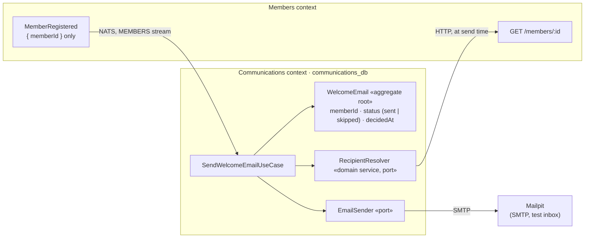

# Communications Service — DDD Architecture Guide

`apps/communications-service` is the third bounded context (CMS-20). Its layering is the
same as the other two services, which [`members-service-ddd.md`](members-service-ddd.md)
explains with diagrams, so this guide covers only what is **new** here: a context whose
work starts from a message instead of a request, a lookup into another context at the
moment of acting, a side effect that can't be rolled back, and ports and adapters for it.

The design comes from [ADR-0005](adr/0005-communications-context-aggregates.md) and its
CMS-20 addendum. The words (welcome email, sent, skipped, recipient) are defined in
[`apps/communications-service/GLOSSARY.md`](../apps/communications-service/GLOSSARY.md).

---

## 1. The model at a glance

One aggregate, `WelcomeEmail`, with one invariant: **at most one welcome email per
member, ever**. That invariant can't be checked inside one aggregate (it's about all of
them), so the database enforces it: `memberId` is the table's primary key
([`schema.prisma`](../apps/communications-service/prisma/schema.prisma)).

There's no "pending" state. The decision is recorded once it's made, and "no
`WelcomeEmail` yet" means "not done yet".

## 2. Why a new aggregate, and not ADR-0005's `MessageCampaign`

ADR-0005 models three aggregates, all admin-driven: announcements, prayer requests and
campaigns (bulk broadcasts). A welcome email is a different kind of message: a
**transactional message**, to one person, caused by something they did. Bending
`MessageCampaign` to fit (a campaign of one, with no admin, created by an event) would
blur what "campaign" means in this context. So the CMS-20 addendum adds `WelcomeEmail`
beside the other three, which stay deferred (they need Identity and Groups).

## 3. The use case, step by step

[`SendWelcomeEmailUseCase`](../apps/communications-service/src/application/SendWelcomeEmailUseCase.ts):

1. **Already decided for this member?** Then it's a `duplicate`, whatever the message id.
   This covers a second `MemberRegistered` for the same member: a replay by hand, or an
   outbox bug upstream.
2. **Ask Members who it is**, through the `RecipientResolver`. This happens *outside* the
   database transaction, so no transaction stays open while another service answers.
3. **Inside `UnitOfWork.runOnce(messageId)`**: an archived member gets `skipped`; an
   active one gets the email, **sent first, recorded after**.

Each outcome (`sent`, `skipped`, `duplicate`) becomes the `outcome` label of
`messages_consumed_total`, so the Registration journey dashboard shows Communications'
work next to the other consumers (study-guide §15).

## 4. A side effect that can't be rolled back

Every other consumer in this repo changes only its own database, in one transaction with
the processed message id, so a redelivery changes nothing (ADR-0010). An email is
different: once SMTP has accepted it, no rollback can call it back. Something can always
go wrong *between* sending and recording. The only choice is which way it goes wrong:

| Order | If it fails in between | Guarantee |
| --- | --- | --- |
| **send, then record** (chosen) | the redelivery sends it **again** | at-least-once: a rare duplicate |
| record, then send | the email is **never** sent | at-most-once: a rare lost email |

A duplicate welcome is harmless; a lost one goes unnoticed. So we send first. A real
provider can narrow the window with an idempotency key, but can't close it: exactly-once
delivery across two systems that don't share a transaction doesn't exist.

## 5. Ports and adapters

| Port (what the use case needs) | Adapter (how, today) | A later adapter |
| --- | --- | --- |
| `RecipientResolver.resolveMember` | [`HttpRecipientResolver`](../apps/communications-service/src/infrastructure/HttpRecipientResolver.ts): `GET /members/:id` on members-service | a local read model, kept up to date from Members' events |
| `EmailSender.send` | [`SmtpEmailSender`](../apps/communications-service/src/infrastructure/SmtpEmailSender.ts): SMTP to Mailpit | Resend's API (ADR-0005's deferred list) |

The use case's tests use in-memory fakes for all four ports; each adapter has its own
test against the real thing (a fake HTTP server, a real Mailpit, a real Postgres).
Swapping an adapter changes one file and its test, not the use case.

How the resolver's answers turn into NATS's answers:

| Members answers | Resolver returns | The message is |
| --- | --- | --- |
| 200, a member | the recipient | handled (`sent` or `skipped`) |
| 404 | `null` → `MemberNotFoundError` | terminated (`term`): retrying can't help |
| 5xx, timeout, no answer | `RecipientsUnavailableError` | retried with backoff (`nak`) |

## 6. Only new registrations

The durable consumer is created with `DeliverPolicy.New`: it starts at the end of the
`MEMBERS` stream. Without it, the first start would work through the last 7 days of
registrations (the stream's `max_age`) and send late welcome emails. The policy only
applies when the consumer is *created*; after that, a restart resumes from where it
stopped ([`ensureConsumer`](../packages/events/src/nats.ts)).

## 7. Known gaps (deliberate)

- **No authentication on the lookup.** members-service answers anyone inside the
  cluster. Service-to-service auth waits for the Identity context.
- **No business API.** Nothing lists welcome emails over HTTP; the inbox (Mailpit) and
  the metrics show what happened. An endpoint comes with the ticket that needs one.
- **Synchronous lookup.** If Members is down, welcome emails wait (retried with backoff).
  A local list of members, built from Members' events, would remove that dependency, at
  the cost of a copy of person data in this context.
- **Announcements, prayer requests and campaigns** (ADR-0005) stay deferred: they need
  roles (Identity) and recipient groups (Groups).

---

## Quick reference — what's new compared with Members and Events

| Idea | Where |
| --- | --- |
| A context whose work starts from a message, with no business API | §3 |
| A lookup into another context at the moment of acting (thin event) | §3, §5 |
| A side effect that can't be rolled back: at-least-once on purpose | §4 |
| Ports and adapters for an external system (SMTP) | §5 |
| An invariant across all aggregates, held by a primary key | §1 |
| A consumer that starts at "now" (deliver policy) | §6 |
